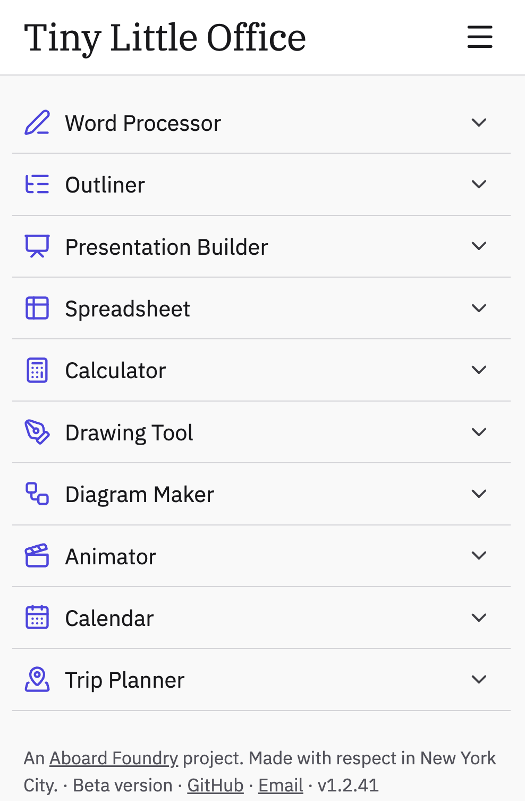

A fun discovery from this recent [Vergecast](https://www.theverge.com/podcast/1019019/todays-vergecast-files-are-over-all-you-need-are-urls) episode: [Tiny Little Office](https://tinylittleoffice.com/).

Documents are stored in the URL fragment. For example take a look at [this url](https://tinylittleoffice.com/#/v1/deck/yrZprbxz1Fcbf76eYUlWAO7vZi9deL0ol27kQmjRubJFe1EZj79gePJ5ZdtY4boKUcCmolKpVAjQVQqLNvaEkXFRCS_oiX8B~UzvvLETTQuA79PecmVmvnRTxoii253~_nHOe85zzp2~hAxF6BoTLpqYCIP5g0KXBOTw7iwwLmNsivRaDViQ7KXQ7XpQEurCmk4RBy9~xx0q5WKlNVavNcvkntgxX0AyDaKH5gNmd3h0UZObqJjOWiec~orR1naaDmHiQUIdEsHubJFkKUCZDHyzbmwHnIxRToEFZjgmxGwb+Nx2ErSfFHQMwse2lb2XJIYfCMD1DgAYU6rRbeLDF4Yb42pulmHkXN32b4eNwWxmVb14qCKMPAmbgdCJ76zsKAw20A0LPursAlmgPNukzL0P41EbFuIoXK5UizrRRQLl3TNK6FU~EjdLAExEmvrC1c6tufoFE~O72BEmO5AuHMrIfDzu55mTsRYRA29d314zgiu2owrGVykopygCntv93mVrh_5loI7Fh8deUQU67RlINZaGnjJhbPmcWfcTZTnMSk13frwnx0intPUCj2bM62yTBTeMP0VNm4KIFqWiOBFAo+ntatJ~qGluSTUDafP0Lz0wyNcIcpaBGSWozD20NeJPftcZ~IH~93ebinGmPlEHETI5GjcabnO3uMzfug6hycOHXSd_RM_cp0D45O5JBPkgwbiZrNLP3RgijUBMLhE7zKbbbGiqGskjHX7Ss7YUhBq8IlSMBNHdsU_RoXkGsM4XpBVmtZnV686rHks9jqtThwvsptn4s4KR8gMlD12cCdYhIt2RrN~txu4IgKJT9vhGd_jlGNL0xC~uSWGj3ZmEDB9571wYVrTshLwbRbEP~cXEEDd4DQrh5qDTzwnlMOq8U7+BjD7aEBXOgc~N5AOmPXibJJ1ZmPyQaWqmEJlAMuPyw9m~65qFcBWlTk2TAduJZzCKGPwFOJc7HA5UHXXYjil7bFc_LZ_bhyh7RMgin0uZjjuJm0IMrBXnmeCnpdsDAzlV0tWkPKc6ODDgosxiwajzkhlOx_edp~Jp7gO54C4gKjHyb0pccgNTItCJ2yM~KC6KAT31EuDTLF9OYxQ1hwKIylinuBP5nZ__dCyYy86SlPBK0C8jk1E8HbcwX0~mWPpZNsckXFCGx~4W5ftsIi9hrfh4oYDucFbnSJx45mSAjFE+zlPzeu_LCYZCYIGfjuIuxpQRLbZwiRUpsNYEklZwDXSi~tCHFKKxUhiIDMv2QfPpgA6RPukUIFMZ4eKmL9clpshEIgArS4v8B9OZJ1UhEwTYWnRNEJX64~6G6zvnQs5mTHYWDs0mxZ2knpBr74y6E3Npijv~qwzEhA4PXnhuInQXfb8ug0vmEHGZk6bxsKunV2OS9fQE_Xm9TlfK2XU3AXvvQNAe2fjDe7lSycVCYea2lZW1AtGJBR9b8zdyLNp4LO8MWH~DiLrJbh1wDMpKnKrGeRePIFodIu1FpmawBuNQ+6s3xTL0NbeLRZcL~k~5lx05kE4lAJkZxU06w5cea8kCjGVCBlQBrfT2NsFnkMSK01HlVIddI54gUJ54Owz3qdHpPcH3thxjR3sNkCEYszzHetUi_zp1ovl8tWWRmkWG9Ut9dWKxQbg~UdtQ2KlXJ1uN6rBhcclSq1kcGtzqqtVFU9NNjYUT2i6pGR8vY5qkMqVoZrW71PTAdzu8caz~bC24fzXCK4dA1CiQ_8MKSQHl7SF2sGIkYzv4jWCAlMxJl6EZxss8dldAV_cdQnrCSq86IFf0XsYnrlWw8WSmJdCsL+SpjNeaY7XcYHDzb0j1glqvMj2p2JR4kXZ2RatHk0I0tvm4swDnHSe9CDPWYed8tomOyLb7jzBZyuOgGoq9~FR~bPbQutw5VjaMMBhOmDZsblgVgT9vmGVKncd~UWIoaM~_VNxU8eot7GqH03nsn4aWi9kPfGfcn4MmaViYE7FYwIFf1fF1GXnCiOIMhs72sJoNNTLPmwygxRdSKPX8QhmCiDlqxRtlaSYD8vnQZcJ0k46~b~~Qn4uArgD~yyEq5Zd5yFVP4Q7R3LV8qN9_beOtWNE2vDAMX273DEoa~kbZcq+cztVT6NFM4~TlwZOl7pIXOl5AMM8uH4ZbSoAlcQ_xYIF3T4d6jHg2hO0C5YqbtuGPF85gLN0YojgVtEGgkNBCYDreazEVV8cCnq7l7Ja1lrjSFgC_kFCuNwiD2nw8Yh2~66QtjzoDTqXxnUI37rLh3fKTW418MCZr2~UMbR2267XxexyDVJxA3o5h5ikPZEYh1y9OThAF0TT36oWAHPJvz5NmW~JSk_5jAsczQdh09nB8C9HiOLRjWRypbl6I2Y72ogL8u8A79XdulskycE7drdf1SjYuj5wVMitWVpB8X3T+8NVa7zYIFCMJZgVxFvwxIpxVFp_uyHjUh5v1dJm2vhRk1ysAMbjUbXpZfc5Yo6HoF~QWryf7mPzqyNapBS_Q32tFzGeHt2~JpntJz_BXnTiPFdnDcRzc7kAVTPqfRPo5UglbqILnk1D8S_5JbzWgstKwfawkppa0IK_AQ6CJxxULGf1ppjXWG1BN9yLumsThXbYnPZpqQahrjgPMqr5rzC2J6S6Za6XBkRH2rQjtMU5PirXluViSjaLFNlonNptqiH5PxTOCFPWaVJmCLyhyKzdvwyaW28rBZn8f9sG10Mp_+h6LxiTOlyRhCVDlSa5L7ZnOL3~oY3jdKgknEumkMZ22CeuDOX8QcYtbcYAPGilJSS5WCRNKo~RV5kWnw~6UeRGslDyEQy6mHxP~lhpEKjUUGj57LIZJvgZsipkXayS206jxMxsCI50wXSoVFAPJshiUfBRs0iSp1haLAw2~ZvIzfCXkpRnkE~wjKXYUBSwcgXLHvZEsRmi500YNuKHtkrZnpQHonBJbxw3IYn4Wfhof93m5Xbk5WlzEi_VCrrV76FQpDZaS03WP2UZbTpUdNJUmqTW21NXcQIBgYO~t1PT52+DBsbpf~S4zNkac9KKQxql4bZsBdcy4joN1xl2nSHXgXsMuk7NdaquUykUzHrp9n04zNYpC2bpbn1k2K3Wam7Zrbjlx5yqvoqNclp2g8ecoZpbrQ~7ZKiGqRhUZcGQhK~smw2r1kfoNNhwGTzoFmtlt5UOLg~5xZHBvuqCYQ3fVY2oaUqbhM6VeoWferpQwW7ErZerTPC1GyzWhwbdSlmdaqWqbbHnXQT4Um9DHpxqqoRphBaSRxVuSYnyRIn4Yn~o5jn7D~xLuTwRw~IOX2p5axhf9pV7TuszLRoHkEBJSHu+TdIlx83NUEf0tkGdpmzQAMjKAw8UyScAG7pMMYLEywm_wMBY_U2iBQ_JDcgY4InOmOwaNNGvlYrVig5RgMXOO0X5RUx1uf8xDCbn8sY5S4icIP~LObu3v2f6ZRtAkW15pSIITUpTgosWxdoPZtvPx6XF2zjBoM9TZESkbMAcnzHONPT0oZrM0IbkQYveZoEs80j_Y8p8y87wO8yqnmyGfjYyUSNnzhMC5S1D54GMwpqKr0DG0iTG5sm~weY0btrXGQ960MiYFnPXcoNLu4CUveilMCkvlDZVnZE6UqhcUCit+N9XIdguCRsRPEPkjHImXHLCLt1y9gHZLWgWmR1Y_ynECXCuuzlaJW6Rsm_h~MaQeDZNpy~bVGabhaleEVR0rEbvqaILVy~wpRE3mnCEKhA4_54e0r5MFQrtR8CAHx8YvCa~QHob19yStMojkdL522Ua4qwmPaWqOiiHPCjzzmtm1nXlgK4uaPkJq1q0Qur6k4zttnpoNWLCZeY4qhstBPe6wPC42OkobLRih7ypNY8hiRRvRUEM3bhpUUjRGT1GiGZ6zxOFictr0NlkvVcs2O3CgNVsr6khyfiHFcbPFgQL8+OLwZK5dkaQDAnTcKY5xacvJG4inZiB2yUhqoj2pPaLBj1sGJvphNjeqn_UkqFPe33gl66aZJA3mwDX6Z8YGSGPCkH3j3ktQEA4ZdRUVTL03N1_oirt4bSthSG8nX4Tf747W1pJnR~KeURU8t0XilaIJzXFgqVoiTTAMctigJT7ksY7I3mUO55Sj6WcPtGrDcyQDVC4Dwx7PGXujxdUxdA9AOS0tI8nzOxDIyyHYfJgtyj6BGPprevJs4jgqUgfFQ~quOv3H4PRrkSJCtQorVTa8~vnV47vfrx6kerN~mw9vz+qx2unVq~vvbH6CQ2_puE61et_XP_d~uX1c~tXCxuX7rywcXPjxsblO7_auELbxiUK7955Wd3OrZ_75wfrZ_h7pbB5_ubm~X9snr~8eeHVzfMXNy~cosfmxWubF29tXnxu8~J7fFBz940Ld9~89p~rbxW~eu3NLz5858vXP6D233859dknZz776J27r7~k4s3Tn__5bFo0WgZ1E_9SEiq_XpAjXkBeCJlnJvLVvGmPg4GlLNkrGqOQL32qJQXGgwMeie5iYf1ytLdTZNiXB8zzguKHSq_uDXtNMZJyYOl~ZIk+5iPPWMF5THuYhjzwqI7lvJfoX4G7G5QHBECHwqXpwirZ8MdANNT2o1YrO6tnVW4jl~dW_r36IWJ5zPj111ll7de251VuOpLf2yurfJCi6rp9df2v9bX7~oM_X1n~rP5ckDwqX6SDx3Xlx4_2Nq3d~ufGuc~clBGcivYEcL2_8lS7c8d23__Sv6zfu_v7dz8_cuvubC1Teu_bRly~8~cX1U84X719y7l06_dXpa1~~9eK9V16~98r5_A3IUrppri7L_Mg5~B2CauFGLipxaWu1jHGeSFQkui3IfLpDIk~Pg7j+HFYXRoZ~~rZVw1YbVT3cK890uXHfXrgf2yY1fTzl5epsnnSy9aP~vhPGSVLoGwSTr08x_qfBf).

Everything after the `#` is the document, modify it and the output is different.

This means that for documents small enough, to fit the whole thing in a QR code:

A nice included feature is that you can embed different document types in other document types, for example [a word document in a slideshow](https://tinylittleoffice.com/#/v1/deck/yA2FUsw0NdI0sQgxNrUwMosDSQKdbAS3Shdrplgi0jAvsgczE9KLEXLCibGDoWymUpeblQYxVcARiJ7D3AA).

It's a tidy way to increase the depth (flexibility) of the tool without increasing it's breadth (number of tools).

They're apparently using some custom markdown to do that. I need to read into that :)

I built [XTDB Play](https://play.xtdb.com/) using the same URL fragment ideal which I copied from the [Squint playground](https://squint-cljs.github.io/squint/).
